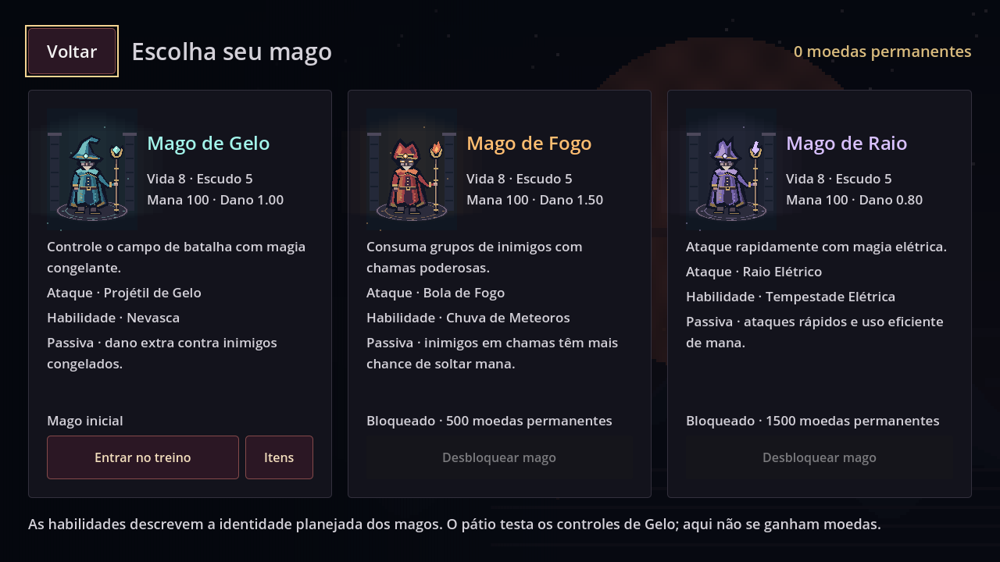
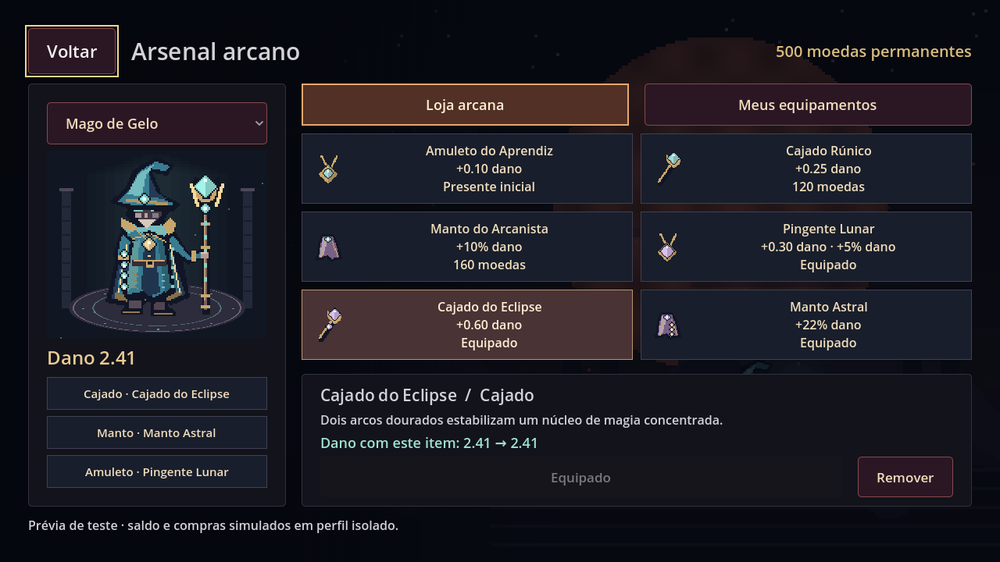

# Crimson Mage

Action roguelite 2D top-down em pixel art dark fantasy, desenvolvido em Godot/GDScript para Android e iOS. Repositório: **Kzim-Start/Projeto-Chat**.

## Escopo atual

A entrega inicial cobriu as seções 0–10. A continuação integra os menus e controles das **seções 10 a 15**, mais a ampliação autorizada em 11/10/2026: **magos detalhados em pixel art, loja de equipamentos e combinações por mago com bônus de dano**. O documento mestre começa na seção 1; a parte 0 foi a preparação. Seções e blocos de desenvolvimento têm numerações diferentes.

O projeto é incremental. Existe agora um pátio funcional para testar movimento, disparos, magia e dash. Campanha, runs completas, chefes, APK/AAB e publicação nas lojas ainda não pertencem a esta entrega.

## Abrir e executar

1. Instale o [Godot 4.5.2 Standard](https://godotengine.org/download/archive/4.5.2-stable/) — não é necessário .NET.
2. Clone ou baixe este repositório e importe o arquivo `project.godot` no Godot.
3. Pressione **F5** para executar o projeto.
4. Abra **Configurações / Settings** para escolher português ou inglês. Volte e siga **Jogar → Deserto Carmesim → Mago de Gelo → Entrar no treino**.

O joystick à esquerda move o mago; os comandos à direita disparam, conjuram e fazem dash. Em aparelhos, dedos diferentes podem agir simultaneamente. No PC, o mouse emula um toque para experimentar cada controle; os atalhos desktop da seção 16 ficam para a próxima etapa. O pátio não oferece moedas e não conta como campanha.

Para experimentar os itens com saldo zero: **Equipamentos → Amuleto do Aprendiz → Resgatar grátis → Equipar neste mago**. Depois entre no treino: o ataque do Mago de Gelo passa de **1,00 para 1,10**. A compra e a escolha ficam salvas ao fechar o aplicativo. Remover o item devolve o dano anterior e mantém a peça no inventário.

## Equipamentos

Cada mago desbloqueado guarda um cajado, um manto e um amuleto. A propriedade é compartilhada: um item comprado pode ser utilizado nas combinações de diferentes magos. Só a combinação do mago escolhido afeta seus ataques básicos. Preços e bônus são configurações iniciais para balanceamento.

| Item | Espaço | Saved Coins | Bônus de dano |
| --- | --- | ---: | --- |
| Amuleto do Aprendiz | Amuleto | Grátis, uma vez | +0,10 |
| Cajado Rúnico | Cajado | 120 | +0,25 |
| Manto do Arcanista | Manto | 160 | +10% |
| Pingente Lunar | Amuleto | 280 | +0,30 e +5% |
| Cajado do Eclipse | Cajado | 340 | +0,60 |
| Manto Astral | Manto | 380 | +22% |

O dano é `(base + soma dos bônus fixos) × (1 + soma dos bônus percentuais)`. Trocar uma peça substitui seu bônus. O arsenal mostra o dano atual e a previsão com o item selecionado. A habilidade especial do pátio mantém o dano anterior; esses itens descrevem bônus para ataques básicos.

Compras pagas usam somente **Saved Coins**, que começam em zero. O pátio não fornece moeda: a obtenção por vitória e o banking pertencem à campanha futura. O presente inicial permite testar inventário e equipamento agora sem criar uma terceira moeda.

## Prévia real da engine





A imagem do arsenal equipado usa um perfil de teste identificado na própria tela, com saldo e compras simulados. As demais capturas estão em [docs/previews](docs/previews).

## O que está implementado

- Boot e navegação entre menu principal, mapa, magos, equipamentos, configurações, melhorias, créditos e pátio.
- Cinco Autoloads com responsabilidades separadas: configurações, localização, catálogo global, progressão e navegação.
- `MageData`, `EnemyData`, `LootTableData`, `EconomyData`, `StageData`, `EquipmentData` e `GameCatalog`, com validação integrada.
- Apenas Gelo disponível inicialmente nas definições; Fogo = 500 e Raio = 1.500 Saved Coins.
- Português brasileiro e inglês com detecção inicial e preferência local.
- Preferências gravadas por arquivo temporário, com backup válido e proteção contra schemas mais novos.
- Testes nativos de dados, localização, UI, recuperação e persistência entre processos.
- Menu com arte original animada; mapa com seis regiões; seleção de magos com retratos e habilidades descritas.
- Compras reais de magos e de um upgrade de vida, usando perfil permanente local. Saldo inicial zero; obtenção de moedas por vitórias depende da campanha futura.
- Pátio de treino com comandos mobile e projéteis em armazenamento limitado, alvos que reaparecem e mana regenerável.
- Magos com oito poses de respiração/manto, silhuetas elementais, luzes, bordados e camadas de equipamento. Retratos e personagem do treino usam os mesmos sprites.
- Perfil permanente versão 2 com inventário e combinação por mago; migração de versão 1 preservando saldo, desbloqueios e upgrades.

Dados de combate, drops e loja são valores iniciais para desenvolvimento, ainda sem playtest de balanceamento. Retratos e animações atuais são pixel art original construída em código. As habilidades finais e passivas dos magos não estão sendo declaradas prontas pelo pátio de controles.

## Testar

Com Godot no PATH, no diretório do projeto:

```sh
godot --headless --editor --path . --import
godot --headless --path . --quit-after 1800 res://tests/test_runner.tscn -- --test-mode
```

No Linux/macOS com Bash, o comando abaixo inclui também o smoke test de boot e os seis testes entre processos:

```sh
GODOT_BIN=/caminho/para/godot bash tests/run_tests.sh
```

O script procura `rg` e usa `grep` como alternativa. O jogo não depende dessas ferramentas. No Windows, use o executável console do Godot para ver a saída dos comandos. As instruções para outros sistemas não significam que eles foram testados nesta entrega.

Resultado atual: **624 verificações de foundation/localização + 73 de menus/controles + 63 de equipamentos, 0 falhas; 6 probes entre processos aprovados**, em Godot 4.5.2 no Linux. As seis telas de prévia foram renderizadas em OpenGL/llvmpipe e inspecionadas em 1280×720. Toque em hardware, Windows, Android, iOS, exportações e performance em dispositivos: **NOT TESTED**. Veja [docs/QA_10_15_EQUIPAMENTOS.md](docs/QA_10_15_EQUIPAMENTOS.md).

## Documentos

- [MASTER_PROMPT.md](MASTER_PROMPT.md): especificação completa fornecida pelo usuário, preservada sem alterações de conteúdo.
- [PROGRESS.md](PROGRESS.md): trabalho concluído, verificações, limitações e próxima etapa.
- [docs/ARCHITECTURE.md](docs/ARCHITECTURE.md): responsabilidades, decisões e limites dos sistemas.
- [docs/QA_0_10.md](docs/QA_0_10.md): cobertura, reprodução e limites dos testes.
- [docs/QA_10_15_EQUIPAMENTOS.md](docs/QA_10_15_EQUIPAMENTOS.md): testes da continuação e do arsenal.

As metas de 60 FPS, diversão e qualidade final exigem medições e playtests; não são resultados garantidos por geração de código.
